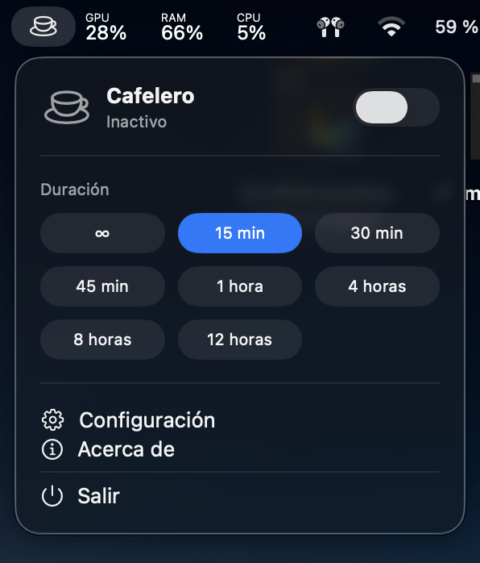

<div align="center">


# Cafelero

**Mantén tu Mac despierto con un solo clic.**

[](https://github.com/pablo96sancho/Cafelero/releases/latest/download/Cafelero-Installer.dmg)


[🇬🇧 English version](./README.en.md)

</div>

<br />

<p align="center">
  
</p>

Cafelero es una app de la barra de menú que evita que el Mac entre en reposo o active el
salvapantallas mientras trabajas, presentas o descargas archivos.

## Características

- ☕️ Se enciende y se apaga con un interruptor desde la barra de menú.
- ⏱️ Duraciones listas para usar: 15, 30 y 45 min, 1, 4, 8 y 12 horas, o **∞** sin límite.
- 💻 Nativa y ligera: hecha en Swift con SwiftUI, sin dependencias.
- 🔒 Sin permisos especiales en el modo normal.

## Instalación

1. [Descarga el instalador](https://github.com/pablo96sancho/Cafelero/releases/latest/download/Cafelero-Installer.dmg).
2. Ábrelo y arrastra **Cafelero.app** a **Aplicaciones**.
3. Ábrela. Aparecerá en la barra de menú.

### Primera apertura

La app no está firmada con una cuenta de Apple Developer, así que la primera vez macOS
la bloquea con un aviso. Para abrirla:

1. Intenta abrir Cafelero y cierra el aviso (sin moverla a la Papelera).
2. Ve a **Ajustes del Sistema → Privacidad y seguridad**.
3. En la sección **Seguridad**, pulsa **Abrir igualmente** junto al mensaje sobre Cafelero.
4. Confirma con tu contraseña o Touch ID. Solo hace falta la primera vez.

<details>
<summary>Alternativa desde la Terminal</summary>

```bash
xattr -dr com.apple.quarantine /Applications/Cafelero.app
```

</details>

### Permisos

Cafelero mantiene el Mac despierto con una *power assertion* de IOKit, que no necesita
ningún permiso. Solo si activas la opción de **respaldo de teclado neutro**, macOS pedirá
permiso de **Accesibilidad** la primera vez: *Ajustes del Sistema → Privacidad y
seguridad → Accesibilidad*.

## Desarrollo

Requisitos: macOS 13 o superior, Xcode 15+ (o las Command Line Tools) y Swift 5.9+.

```bash
cd Cafelero
./build_and_run.sh   # compila y abre la app
./create_dmg.sh      # genera Cafelero-Installer.dmg
```

Cada Release de GitHub publica el DMG automáticamente con GitHub Actions.

## Licencia

[MIT](LICENSE) © Pablo Sancho
